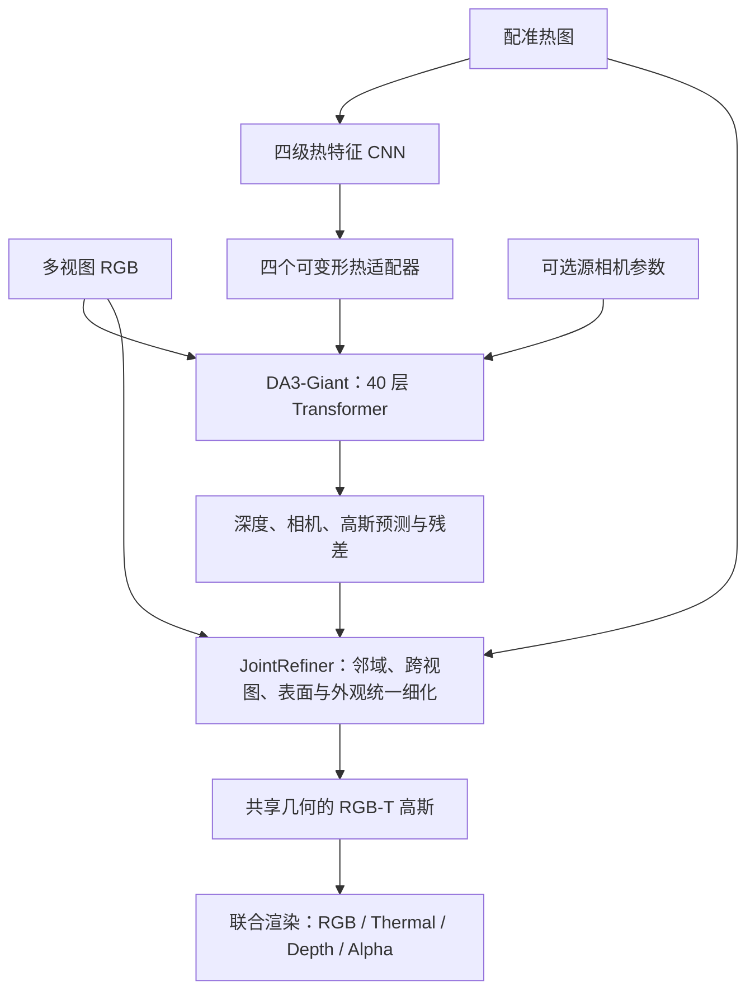
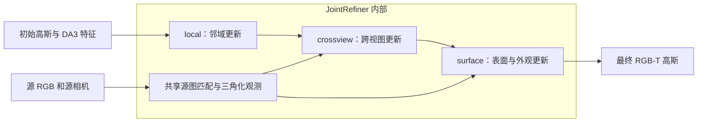

# 历史阶段：三个细化模块的计算融合

本文记录结构合并之前的计算融合阶段，以下“当前”均指该历史阶段。正式模型现已改为重新训练的 `LearnedJointRefiner`，见[共享网络与训练](RGBT_LEARNED_JOINT.md)和[三方验收报告](../outputs/rgbt/joint_release_20260920/REPORT.md)。

历史部署采用 `JointRefiner`，将 NeighborhoodRefiner、CrossViewRefiner、SurfaceRefiner 纳入一个模块，并共享重复几何计算，保留全部学习权重和三个更新阶段。这只属于计算融合。

## 当前结构



顶层是 `reconstruction -> refiner -> renderer`。`renderer` 是函数，不是持有学习参数的第三个子模块。



## 已合并的计算

1. 尺度校准、共同平面锚定和局部深度锚点共用源图对应及三角化观测。已知相机每次完整前向从 3 次三角化降为 1 次，预测相机从 2 次降为 1 次。
2. 邻域阶段的两层注意力共用投影网格和可见性掩码；跨视图阶段的两层注意力共用 3×3 窗口的几何选择与先验。特征注意力仍各自计算，参数保持不变。
3. 缓存只属于一次前向。更换源 RGB、相机，或原地修改相机，会重算源几何；每次高斯更新后重新建立注意力对应。支持 `torch.inference_mode()`，不会跨场景沿用旧对应。
4. 旧的训练缓存仍表示邻域和跨视图更新后的 prior；传入 `initial` 时跳过这两步，避免重复细化。表面训练入口与冻结范围保持一致。

三个已训练编码器的通道数分别为 96、96、48，三个细化算子合计 868,996 个参数；全模型仍为 1,359,077,221 个参数。学习权重逐张量严格相等。当前融合降低重复计算，没有减少学习参数。投影缓存会占用额外临时显存，具体时延和峰值分配见[测量报告](../outputs/rgbt/fusion_study/REPORT.md)。

不同高斯状态的渲染反馈不能直接互换，现有局部幅度搜索、跨视图可信度、表面几何/外观保护仍按原顺序执行。3/6 视图的源渲染调用仍分别为 16/19 次，一次调用可能处理多个相机。

## 验证与迁移

- 对照融合前的代码快照和权重，在 30 场景、每场景 1 个保留目标、3/6 视图、已知/预测相机上共验证 120 组。全部高斯、输出张量及 RGB/T/深度/Alpha 渲染的最大绝对差为 0。
- 已知相机比较保留目标图像；预测相机比较预测源相机下的渲染，不能作为保留目标的重建精度。
- 53 项测试通过，包括缓存失效、注意力输出和特征梯度、几何更新后重建对应；完整/缓存前向等价检查和一次真实训练梯度步骤通过。
- 权重自包含，内嵌 `joint_refinement=true`。旧 checkpoint 仍可加载；兼容属性 `neighborhood_refiner`、`crossview_refiner`、`surface_refiner` 分别指向 `refiner.local`、`refiner.crossview`、`refiner.surface`，不会重复注册参数。
- 融合前代码、配置、权重备份：`outputs/rgbt/fusion_study/before/`。

可复现迁移：

```bash
bash scripts/rgbt_python.sh scripts/legacy/fuse_rgbt.py \
  --weights outputs/rgbt/fusion_study/before/model.pt \
  --output outputs/rgbt/new_joint.pt
```

迁移只重命名权重前缀并开启共享计算，严格加载验证全部权重；优化器状态重置。原权重和已有输出路径不会被覆盖。

## 进一步改成一个学习编码器

可以将三个编码器替换为一个共享 96 通道编码器，将同视图邻域与跨视图窗口放进联合注意力，再由几何、覆盖和 RGB/T 外观三个头并行预测一次更新。共同平面、深度锚定及源观测可信度继续保留，已删除的平面学习头不恢复。

这会改变特征空间、反馈状态和更新顺序，不能将三套已训练权重直接拼接为一个等价编码器。需要在原 14 个训练场景进行联合训练或教师蒸馏，并在完整 30 场景、383 个目标、3/6 视图共 766 组重新验证效果与时延。已有训练缓存是两步细化后的高斯，必须另存初始 `reconstruction` 输出与教师监督，不能直接拿来作为新结构的原始输入。

该后续工作现已完成，使用一个共享编码器和联合输出头迭代更新，而非一次并行更新；本文的零差异验证只适用于旧的计算融合阶段。
