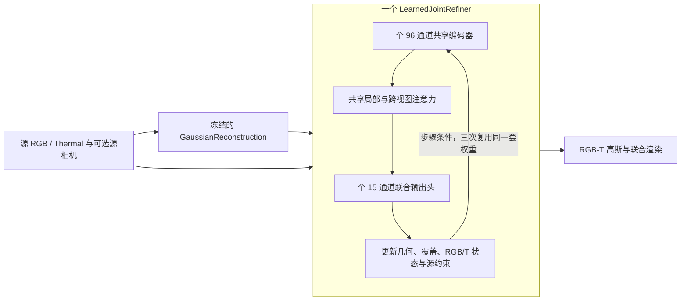

# 三个细化模块合并为一个可训练网络

默认权重 `checkpoints/RGBT/model.pt` 使用训练后的 `LearnedJointRefiner`。原来的邻域、跨视图、表面/外观三个独立网络已被一个共享编码器、共享注意力和一个联合输出头替代。当前默认权重还删除了四个 ViT 热适配器；删除前版本保存在 `checkpoints/RGBT/model_with_adapters.pt`。本页后面的完整质量评测和训练缓存来自删除前版本；当前删减版仅完成 Building img_025 的 3/6 视图对照及前向验证。



这是一个递归复用权重的模块，保留三次状态更新。参数树只有 `reconstruction.*` 与 `refiner.core.*`，不包含 `refiner.local/crossview/surface`，推理不加载教师。细化参数从 868,996 减至 564,815，减少 35.0%。主干仍为 DA3-Giant，总权重约 5.4 GB，不能把细化参数的缩减比例当作整个模型的缩减。

## 已训练效果

采用此前完成的 `run_r/step_3500.pt`，它在该轮验证集的分数最高。此次补齐三方完整评测、训练接口和正式权重切换；不是把原三套权重改名打包，也不是将未训练的初始化作为成品。

基线按用户确认，为未加入三个细化模块的 `GaussianReconstruction`。30 场景、383 个保留目标、3/6 源视图共 766 组，先场景内平均、再场景等权：

|源视图|相对基础 RGB PSNR|相对基础热 PSNR|相对原三模块 RGB PSNR|相对原三模块热 PSNR|
|---|---:|---:|---:|---:|
|3|+1.4709 dB|+1.9356 dB|+0.0073 dB|+0.0234 dB|
|6|+1.5412 dB|+1.8864 dB|+0.0158 dB|+0.0176 dB|

未参与梯度训练的 16 场景同样优于基础重建。相比原三模块，全体 6 视图热 SSIM 下降 0.000183，深度 log 误差增加约 0.000047；最差逐场景平均热 PSNR 下降约 0.395 dB，单个目标可能下降更多。结论是保留效果、允许小幅损失，不是逐目标零退化。

[完整报告、逐场景和逐目标数据](../outputs/rgbt/joint_release_20260920/REPORT.md)保留全部变化。工程验收阈值见 [acceptance.json](../outputs/rgbt/joint_release_20260920/acceptance.json)；此前的严格零退化规则与失败记录没有改写。评价场景以前已被多轮访问，属于回归对照，不称为完全未接触的测试。质量评价使用已知相机；无相机输入完成了功能验证。

## 重新训练

训练使用 14 个训练场景、840 组样本和 4 个验证场景。250 个训练目标与 383 个评价目标不重叠，验证/测试场景不参与梯度更新，审计见 [数据隔离记录](../outputs/rgbt/joint_training_20260920/full_data_separation_audit.json)。

`training_seed.pt` 固定了 run_r 开始时的共享网络初始化；它沿用前期蒸馏权重，因此属于迁移后的重新训练，不是随机初始化训练。重建器冻结，首步所用共享参数和输出通道固定；后两步训练同一网络的跨视图注意力、步骤条件、共享残差层和其余输出通道。训练损失以教师更新量、几何与渲染蒸馏为主，质量损失只惩罚低于教师的结果。

在仓库根目录执行：

```bash
# 使用固定初始化重新训练一轮，共 4000 步
bash scripts/rgbt_python.sh scripts/train_rgbt_joint.py \
  --config configs/rgbt_joint_train.json \
  --output outputs/rgbt/retrain_shared --device cuda:0

# 续训：自动恢复架构、损失、冻结范围、优化器和随机数状态
bash scripts/rgbt_python.sh scripts/train_rgbt_joint.py \
  --resume outputs/rgbt/retrain_shared/last.pt \
  --output outputs/rgbt/retrain_shared --device cuda:0 --steps 6000

# 从交付的已训练模块继续训练
bash scripts/rgbt_python.sh scripts/train_rgbt_joint.py \
  --resume checkpoints/RGBT/training_state.pt \
  --output outputs/rgbt/continue_shared --device cuda:0 --steps 5000

# 快速验证真实前向、反向和优化器更新，不保存更新后权重
bash scripts/rgbt_python.sh scripts/train_rgbt_joint.py \
  --config configs/rgbt_joint_train.json \
  --output outputs/rgbt/check_shared_training --device cuda:0 --smoke
```

输出目录需为新目录，续训除外。`best.pt`、`last.pt`、`step_*.pt` 是共享细化模块的训练文件，包含优化器和随机状态；不能直接传给完整模型推理接口。验证选择不要求每个目标完全无退化；训练日志中的旧 `passed` 字段仍只表示历史严格门槛。

训练缓存包含原始重建、中间状态与教师监督。固定配置直接使用已核验的 `cache_ordered_train_full` 和 `cache_ordered_val`，不会误用已经过两次细化的旧 surface prior。用固定初始化和已有缓存训练，不需要加载三模块教师网络；生成新教师缓存时才需要旧教师权重。缓存生成入口为 `scripts/cache_rgbt_joint.py` 和 `scripts/cache_rgbt_ordered_joint.py`。

## 导出与复核

```bash
# 冻结重建器与新的共享模块合为一个自包含 checkpoint
bash scripts/rgbt_python.sh scripts/export_rgbt_joint.py \
  --teacher outputs/rgbt/joint_training_20260920/before/model.pt \
  --refiner outputs/rgbt/retrain_shared/best.pt \
  --output outputs/rgbt/retrained_shared.pt

# 全部 766 组重新比较基础重建、三模块教师和统一模块
bash scripts/rgbt_python.sh scripts/evaluate_rgbt_joint.py \
  --refiner outputs/rgbt/retrain_shared/best.pt \
  --output outputs/rgbt/retrained_comparison --include-base --device cuda:0

# 当前正式模型：严格加载、完整/缓存前向、已知/预测相机
bash scripts/rgbt_python.sh scripts/verify_rgbt.py

bash scripts/rgbt_python.sh -m unittest discover -s tests -p 'test_rgbt*.py' -v
```

`export_rgbt_joint.py` 只从 `--teacher` 复制冻结重建器，写入训练后的共享模块。导出文件不依赖该路径运行；新训练结果应完成评价后再替换正式权重。训练重新运行会受随机性与数值环境影响，不保证每次逐位相同或自动通过质量验收。

上面的训练缓存和导出流程沿用带热适配器的重建器。若要从新训练结果生成当前的无适配器结构，先导出完整模型，再运行 `scripts/prune_rgbt_thermal_adapters.py --weights <完整模型> --output <新路径>`，并对删减结果重新评测。此次默认权重仅剪除了已训练适配器，未重新训练主干或共享细化器。

## 文件

- `src/depth_anything_3/rgbt/learned_joint.py`：唯一学习核心。
- `src/depth_anything_3/rgbt/ordered_joint.py`：共享权重的迭代执行与无独立学习参数的源约束。
- `configs/rgbt_joint_train.json`：固定训练配方，命令行可覆盖；续训优先恢复保存的配方。
- `checkpoints/RGBT/model.pt`：当前可独立推理的完整模型。
- `checkpoints/RGBT/training_seed.pt`：重新训练的共享网络初始化。
- `checkpoints/RGBT/training_state.pt`：已交付模块的 3500 步训练状态，可续训。
- `outputs/rgbt/joint_training_20260920/before/`：原三模块权重与源码备份。

历史 `JointRefiner` 和三个算子的实现仍用于读取旧权重、教师缓存和回归对照；不会注册进当前正式模型。
